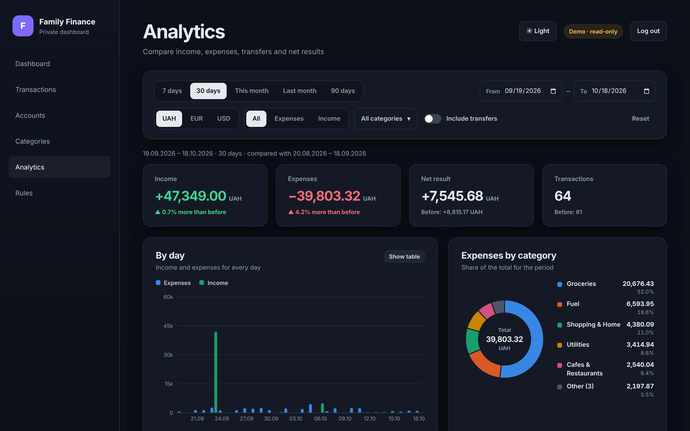
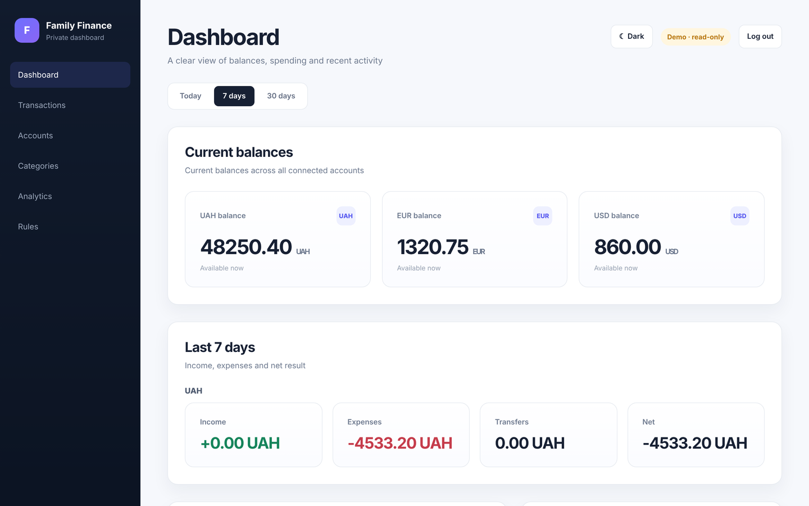
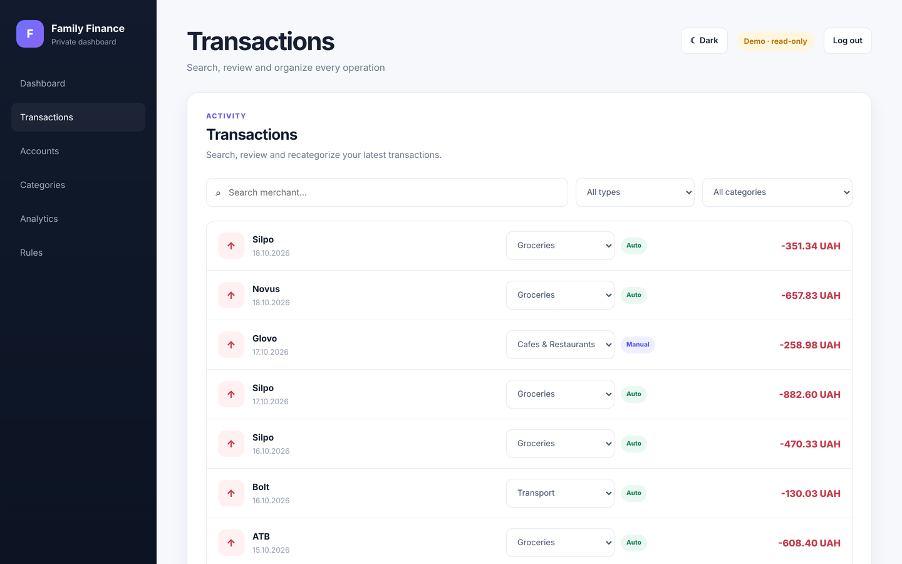

<h1 align="center">💰 family_finance</h1>

<p align="center">
  <b>All your accounts in one place, with a smart assistant that helps you spend better.</b>
</p>

<p align="center">
  
  
  
  
  
  
  
  
  
  
</p>

---

## 🎯 About

family_finance is a personal finance tracker I'm actively building, with the goal of turning it into a product that **anyone who wants to track and control their finances can use**.

People keep their money in many places: different banks, cards and crypto wallets. That makes it hard to answer a simple question: *"Where does my money actually go?"*

With family_finance, a user **connects all their accounts once** and gets **one convenient dashboard** with every expense, without switching between apps or filling in spreadsheets.

## 📸 Screenshots

> All screenshots use **generated demo data** (`npm run seed:demo`), not real transactions.

<p align="center">
  
</p>

<p align="center">
  
  
</p>

## ✅ Features

**Working now**

- 🏦 **Monobank integration**: syncs accounts and transactions automatically, including history backfill
- 🏷️ **Auto-categorization**: transactions are sorted into categories (groceries, transport, subscriptions, …)
- 🧠 **Merchant rules**: teach the app once how to categorize a merchant, and it remembers
- 🔁 **Transfer detection**: transfers between your own cards are not counted as expenses
- 📊 **Analytics page**: spending by category, income vs. expenses by day, top merchants, comparison with the previous period
- 👨‍👩‍👧 **Family members**: accounts can belong to different family members
- 🌗 **Light / dark theme**
- 👥 **Multi-user**: everyone signs up and sees **only their own** cards, transactions and rules
- 🔐 **Login with email + password**, read-only demo account
- ⚙️ **Settings**: connect your bank, change password, security log, download or delete all your data

**Coming next**

- 🏦 PrivatBank integration
- 🪙 Crypto transactions tracking
- 🤖 **AI financial assistant** that analyzes spending, finds ways to optimize expenses and gives personal advice

## 🛠 Tech stack

| Part | Technologies |
|---|---|
| Website | React 19, TypeScript, Vite, Recharts |
| iPhone app | Swift, SwiftUI, Swift Charts, Keychain, Face ID |
| Backend | Node.js, Express, TypeScript, Zod |
| Security | scrypt password hashing, JWT in httpOnly cookies, Helmet, rate limiting |
| Database | PostgreSQL, Prisma ORM |
| Integrations | Monobank API |

## 📁 Project structure

One repository, three parts. Each part has its own guide and its own checks on GitHub.

| Folder | What it is | Guide |
|---|---|---|
| [`backend/`](backend) | Server and API: login, bank sync, categories, reports, database | [backend/README.md](backend/README.md) |
| [`frontend/`](frontend) | Website (React) | [frontend/README.md](frontend/README.md) |
| [`ios/`](ios) | iPhone app (SwiftUI), works with the server or offline demo data | [ios/README.md](ios/README.md) |
| `docs/` | Screenshots | |
| `.github/` | Automatic checks: tests, builds, security scans, Dependabot | |

```
                ┌──────────────┐
  Website  ───► │              │
                │   backend    │ ───► PostgreSQL
 iPhone app ──► │  (REST API)  │ ───► Monobank API
                └──────────────┘
```

The website and the iPhone app never talk to the database or the bank directly:
they only call the backend API, which checks who is signed in and returns only that user's data.

## 🚀 Getting started

**Requirements:** Node.js 20+, PostgreSQL. For the iPhone app: a Mac with Xcode.

```bash
git clone https://github.com/yuran4ik13/family_finance.git
cd family_finance
```

1. **Backend** → follow [backend/README.md](backend/README.md) (database, `.env`, first user)
2. **Website** → follow [frontend/README.md](frontend/README.md)
3. **iPhone app** → follow [ios/README.md](ios/README.md) (or just tap *Try with demo data*, no server needed)

## 🔐 Security

**Every user sees only their own data**
- Each card, transaction, category and rule belongs to one user, and **every database query filters by the logged-in user**
- Ids from the browser are always checked together with the owner: guessing someone else's id returns "not found"
- **Automated tests** sign in as a second user and try to read and change the first user's data through every route; CI runs them on every push

**Bank tokens**
- Each user connects their own Monobank token; it is **encrypted with AES-256-GCM** before it reaches the database
- The encryption key lives only in the server's `.env`, so a stolen database dump doesn't reveal any token
- Each encrypted token is bound to its owner and can't be decrypted as another user's
- The token is never sent back to the browser, not even to its owner

**Accounts**
- Passwords are stored only as **scrypt hashes**; at least 12 characters, common passwords rejected
- The session is a signed token in an **httpOnly, SameSite=Strict cookie** (Secure over HTTPS)
- **Brute-force protection**: max 5 failed logins per email+IP per 15 min, sign-up and sensitive actions rate limited
- Changing the password or "sign out on all devices" invalidates every other session
- **Security log** on the Settings page: sign-ins, failed attempts, password and bank changes (kept 90 days)
- Sign-up is **off by default** (`ALLOW_REGISTRATION`)

**Your data, your rights (GDPR)**
- **Download** all your data as JSON at any time
- **Delete** your account: removes every card, transaction, rule, log entry and token

**Server**
- **CSRF protection**, strict CORS, **security headers** (Helmet), Zod input validation, 100 KB body limit
- Errors never leak stack traces; the server refuses to start with missing or weak secrets
- **Read-only demo role** can't change data or trigger bank syncs
- **Dependabot**, secret scanning, **CodeQL** code scanning and CI (`npm audit` on every push, type checks, security tests)

**Honest limits:** the server has to see transactions to build reports, so whoever controls the server and its `.env` can technically read the data. That's true for almost every finance app; it's limited here by encryption of tokens, the access log and the law (GDPR).

Found a security problem? See [SECURITY.md](SECURITY.md).

## 👤 Author

**Yura**: junior full stack developer, Košice 🇸🇰
GitHub: [@yuran4ik13](https://github.com/yuran4ik13)
